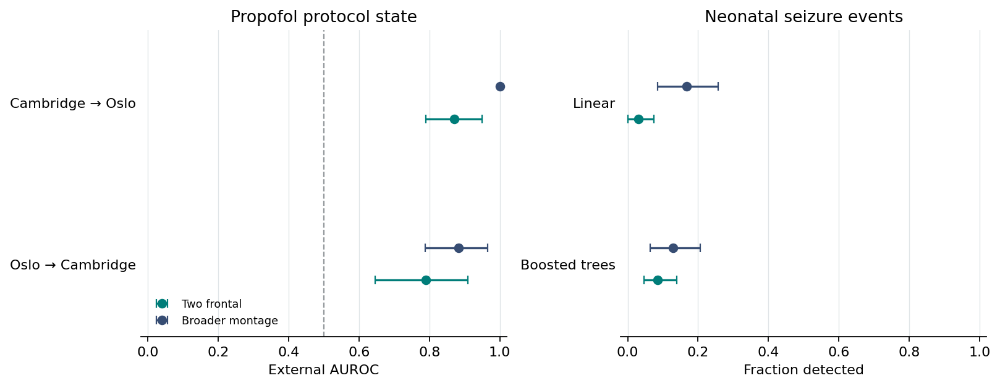

# MindGuard waveform learning analysis

21 November 2026 · Retrospective research

[Neuromuscular blockade and the awake EEG](neuromuscular-blockade.md) includes training on awake-paralysed volunteers, drug-aligned surgical EEG and the failure analysis.

## Neuromuscular blockade: one awake volunteer in six was labelled sedated

In participant-held-out testing on the six published awake-paralysed volunteers, the frontal-alpha comparator labelled **one of six** awake, paralysed people as sedated. Including the awake-paralysed measurements did not reduce that error. The offline replay therefore returns signal descriptors only, abstains before reading model weights, and never sets a consciousness inference. Its optional research number is named `propofol_protocol_state_score`; it is not a depth, sedation-adequacy or awareness measure.

Three models in this directory must not be conflated:

1. **Awake-paralysed frontal-alpha comparator** — fitted to published summary medians from six volunteers; the one-in-six result above.
2. **Propofol protocol-state classifier** — separates a named protocol state (baseline vs sedated/pre-awakening) across Cambridge and Oslo; it is not a consciousness monitor and was not trained on paralysis.
3. **Surgical EMG waveform model** — predicts the monitor's own frontal EMG in dB from VitalDB EEG; the target shares the EEG electrodes, so it cannot independently validate muscle activity or awareness.

Independent validation requires **native waveform EEG from a different cohort**, with the acquisition montage, reference, calibration and medication/event timing available for reprocessing. Published summary figures, screenshots, repeated playbacks of one volunteer and monitor-derived EMG targets do not satisfy that requirement. No independent clinical validation has been performed.

## Propofol state and behavioural responsiveness

The Cambridge dataset contributed 20 people and 80 sessions. Oslo contributed 20 people and 71 eyes-closed baseline and pre-awakening recordings. Cambridge contributed cleaned ten-second epochs. Oslo contributed continuous BrainVision samples. The aligned extraction produced 3,366 candidate eight-second windows before montage quality screening. An additional Oslo awake eyes-open condition was reserved for a control.

The fitter parses the extractor's actual BIDS names (`awake_acq-EC`, `awake_acq-EO`, `sed2_acq-rest_run-<n>`) against the pinned [acquisition manifest](oslo-acquisitions.json), preserving each subject's multiple pre-awakening runs. Renamed, duplicated, misfiled, excluded or unrecognised cache files are quarantined and reported with a reason instead of being scored, and the eyes-open run stays a separate control.

Each row tests the entire fitted model at the other centre. We formed one observation per person and state and computed 95% intervals by resampling complete participant pairs. A pair counted as correctly ordered when the person’s sedated recording received a higher score than their own eyes-closed baseline. Fixed-score frontal delta power provides a simple comparator. The two centres used different sedation protocols.

| Training → test | Montage | Test participants | AUROC (95% interval) | Paired ordering | Baseline frontal delta AUROC | Sensitivity / specificity at 0.5 |
|---|---|---:|---|---:|---:|---|
| Cambridge → Oslo | Two frontal derivations | 20 | 0.87 (0.79–0.95) | 95.0% | 0.34 | 70.0% / 85.0% |
| Cambridge → Oslo | Broader montage | 20 | 1.00 (1.00–1.00) | 100.0% | 0.33 | 100.0% / 90.0% |
| Oslo → Cambridge | Two frontal derivations | 20 | 0.79 (0.65–0.91) | 65.0% | 0.24 | 65.0% / 85.0% |
| Oslo → Cambridge | Broader montage | 20 | 0.88 (0.79–0.97) | 95.0% | 0.24 | 60.0% / 100.0% |

The perfect AUROC in the small Oslo test set produces an uninformative bootstrap interval. Population performance is uncertain.

## Does EEG explain what the participant could do?

Each Cambridge session had a count of correct responses out of 40. We left one participant out at a time across all their sessions. The protocol-stage comparator used the mean count at that stage among training participants. The combined model used ridge regression with a fixed penalty. Positive gain indicates a lower mean absolute error with the combined model.

| Montage | Protocol stage MAE | EEG alone MAE | Stage and EEG MAE | Gain per participant (95% interval) |
|---|---:|---:|---:|---|
| Two frontal derivations | 5.86 | 6.05 | 5.87 | -0.00 (-2.13–1.40) |
| Broader montage | 5.86 | 5.28 | 5.20 | 0.66 (-1.17–2.27) |

Both intervals include zero. Stage classification measures a protocol contrast. The behavioural analysis measures performance on a task. Neither supplies awareness, amnesia, adequacy of analgesia or a validated anaesthetic dose endpoint.

### Awake eyes-open control

The frozen Cambridge model was also applied to the same Oslo volunteers awake with eyes open. Scores of at least 0.5 use the classifier’s fixed threshold. These counts test whether the eye condition alone can move someone across it.

| Montage | Matched people | Awake eyes closed ≥ 0.5 | Awake eyes open ≥ 0.5 | During propofol ≥ 0.5 | Mean score change, open minus closed (95% interval) |
|---|---:|---:|---:|---:|---|
| Two frontal derivations | 20 | 3 | 2 | 14 | 0.05 (-0.02–0.12) |
| Broader montage | 20 | 2 | 2 | 20 | 0.06 (-0.01–0.14) |

## Detecting neonatal seizure events

All 79 Helsinki EEGs were processed. They provided 111.82 hours in complete windows and 111.82 hours with three valid annotation streams. The three readers disagreed on 8.6% of jointly labelled seconds. At least two readers marked seizures lasting ten seconds or longer in 46 babies.

Five outer folds held out whole neonates. Three folds fitted the signal model, one separate fold calibrated probability and the operating threshold, and the fifth fold tested both. Each baby appeared in the test set exactly once. The threshold was chosen to maximise detected events subject to at most 0.5 false alarm starts per background hour and at most 5% of background time in alarm in the calibration fold. The test set can exceed these limits.

| Montage and model | Window AUROC (95% interval) | Average precision / prevalence | Events detected | Event sensitivity (95% interval) | False alarms per background hour (95% interval) | Median detection delay, detected events | Coverage |
|---|---|---|---:|---|---|---:|---:|
| Two frontal derivations, linear | 0.61 (0.54–0.66) | 0.19 / 0.13 | 15/483 | 3.1% (0.0%–7.5%) | 0.11 (0.00–0.33) | 74.0 s | 98.1% |
| Two frontal derivations, boosted trees | 0.66 (0.58–0.72) | 0.25 / 0.13 | 41/483 | 8.5% (4.6%–14.0%) | 0.24 (0.08–0.41) | 50.0 s | 98.1% |
| Broader montage, linear | 0.66 (0.60–0.73) | 0.30 / 0.13 | 81/483 | 16.8% (8.5%–25.7%) | 1.00 (0.25–2.14) | 42.0 s | 96.5% |
| Broader montage, boosted trees | 0.73 (0.67–0.78) | 0.41 / 0.13 | 62/483 | 12.8% (6.4%–20.6%) | 0.34 (0.11–0.67) | 41.0 s | 96.5% |

An alarm begins at the end of the second consecutive positive eight-second window. An event is detected only if an alarm starts during that event. False-alarm rates count alarm starts during labelled non-seizure seconds divided by those hours. Rejected signal windows count against event detection. Window discrimination is calculated on windows with valid signals and expert labels. Event and false-alarm intervals resample whole babies. They condition on the fitted folds and this single-centre case mix.

### Transfer to older patients

We applied the fixed neonatal boosted models, calibrators and thresholds to independent CHB-MIT paediatric and Siena adult data. We selected a continuous excerpt around the first annotated seizure per subject and an additional ten minutes of a seizure-free record in CHB-MIT where listed. Because excerpts are enriched for seizures, these rates cannot establish alarm burden across unscreened hospital monitoring.

| Cohort | Montage | People | Hours sampled | Covered | Events detected | False alarms / background hour |
|---|---|---:|---:|---:|---:|---:|
| CHB-MIT | Two frontal derivations | 12 | 6.06 | 93.4% | 5/12 | 39.74 |
| CHB-MIT | Broader montage | 12 | 6.06 | 87.9% | 4/12 | 27.06 |
| Siena | Two frontal derivations | 6 | 2.11 | 91.4% | 2/6 | 3.51 |
| Siena | Broader montage | 6 | 2.11 | 87.8% | 2/6 | 4.51 |

Transfer exclusions recorded by the reader: none.

## Parkinson’s medication sensitivity

Using the previously fitted New Mexico model, we scored 13 complete raw pairs at UC San Diego. Participants had the same underlying diagnosis at both visits. The mean ON minus OFF change was -0.131 on its 0–1 research score (participant bootstrap 95% interval -0.27–0.02). Median absolute within-person change was 0.233. 3 of 13 had higher scores on medication. The paired Wilcoxon p-value was 0.080. This checks score stability in a small paired cohort. The dataset authors advise against training diagnostic classifiers in this small cohort. No new diagnostic classifier was fitted to it.

## Signal processing and reuse

The propofol models used 13 measures per bilateral region covering amplitude, relative spectral power, spectral entropy, spectral edge, peak frequency, line length, peak-to-RMS and autocorrelation. Frontal derivations were Fp1–F7 and Fp2–F8. The six-derivation configuration added F3–C3, F4–C4, P3–O1 and P4–O2. The neonatal broader montage added T3–T5 and T4–T6. Oslo data were resampled to 125 Hz and 32 seconds per selected run were analysed, starting six seconds into the run. The Cambridge features used the central eight seconds of each ten-second epoch at the same resampled rate. A basic signal quality screen rejected flat, nonfinite or extreme peak-to-peak signal. Residual artefact and transient within-procedure changes require separate evaluation.

Cambridge ZIP members passed CRC checks. Helsinki EDFs and expert labels passed release MD5 checks. The UC San Diego BDFs were checked against the tagged repository’s annex keys. Oslo and the older-age transfer checks used HTTP byte ranges from published objects. Oslo links are versioned at the catalogue level, while the sampled S3 objects are accessed through current public paths. Names, montage, units and sample frequency were checked in the readers. Agreement between sessions cannot establish event-level clinical responsiveness.

The recorded estimates apply to these selected cohorts and research montages. The intended device has yet to be validated prospectively, and this release contains no paired comparison with BIS on a clinical outcome. The repository contains aggregate results and fitted research parameters. Raw EEG and participant predictions stay out of the app.



## Reproduction

From the repository root with Python 3.9–3.12 and dependencies from [requirements.txt](requirements.txt), run the commands below. The retrieval scripts can resume after an interruption. The Cambridge and Oslo cache directories must contain the completed study extracts before running the fits.

```sh
pip install -r research/learning/requirements.txt
cd research/learning
python sedation.py cambridge cache-cambridge
python sedation.py oslo cache-oslo
python sedation.py oslo-eyes-open cache-eye-control
python waveforms.py cache-neonatal
python fit_state.py . results
python eye_check.py . results
python fit_seizures.py cache-neonatal results
python transfer_seizures.py prepare cache-transfer
python transfer_seizures.py score cache-transfer results
python medication_check.py cache-medication ../../docs/eeg-disease-discovery-results.json results
```

The [propofol weights](results/propofol-research-weights.json) use the two combined cohorts for a research refit. External scores above belong to models trained in a single source. Each [frontal](results/neonatal-frontal.joblib) or [broader](results/neonatal-broader.joblib) neonatal artifact is a boosted model fitted on four folds with the remaining fold used for its calibrator and threshold. As with all Python joblib files, load only trusted files that match the project [SHA-256 manifest](results/SHA256SUMS).

The six-participant fit pins the supplement's SHA-256 before extracting any measurement and refuses a different file. The next independent comparison follows the [locked external-validation protocol](external-validation-protocol.md); its text is hashed in `external-validation-protocol.sha256`.

The [offline replay tool](replay.py) accepts an NPZ with a scalar sampling rate (hz), units (unit = uV), a list of bipolar derivation names and a waveform array shaped derivations × samples or contiguous segments × derivations × samples. For neonatal replay supply 256 Hz data and separate each discontinuity into its own segment. Propofol replay returns one aggregate score per input session. The admin research view summarises held-out results. No research score feeds a bedside alarm or drug recommendation.

## Sources and attribution

[Cambridge, Chennu and colleagues, data and CC BY 2.0 UK terms](https://www.repository.cam.ac.uk/items/b7817912-50b5-423b-882e-978fb39a49df) · [Cambridge behavioural field definitions](https://www.fieldtriptoolbox.org/workshop/madrid2019/bids_sedation/) · [Oslo, Bajwa and colleagues, OpenNeuro v1.0.0](https://doi.org/10.18112/openneuro.ds005620.v1.0.0) · [Oslo depositor attribution and CC BY 4.0 notice](https://github.com/OpenNeuroDatasets/ds005620/blob/1.0.0/README.txt)

[Helsinki, Stevenson and colleagues, Zenodo waveform and annotations](https://doi.org/10.5281/zenodo.2547147) · [CHB-MIT, Shoeb and colleagues, PhysioNet v1.0.0](https://physionet.org/content/chbmit/1.0.0/) · [Siena, Detti and colleagues, PhysioNet v1.0.0](https://physionet.org/content/siena-scalp-eeg/1.0.0/)

[UC San Diego, Rockhill and colleagues, v1.0.5](https://doi.org/10.18112/openneuro.ds002778.v1.0.5) · [Jackson et al.](https://doi.org/10.1523/ENEURO.0151-19.2019) · [Swann et al.](https://doi.org/10.1002/ana.24507) · [George et al.](https://doi.org/10.1016/j.nicl.2013.07.013)

